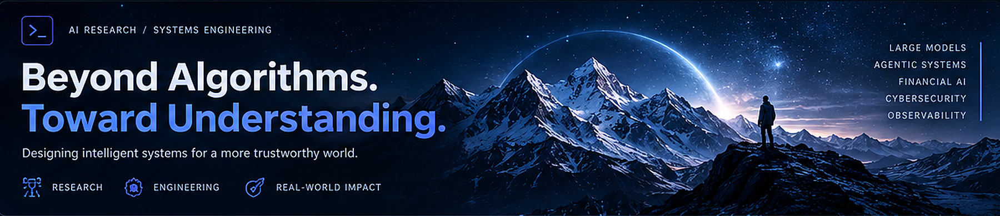

# Amir Mohammad Ranjbar

**AI Engineer & Systems Architect** · **PhD Researcher in Artificial Intelligence**

---

<table>
<tr>
<td width="58%" valign="top">

<h3>👋 About Me</h3>

I work at the intersection of <strong>AI research,
systems architecture, and production engineering</strong>.

I design intelligent applications end to end—from machine
learning and retrieval pipelines to backend services,
infrastructure, and deployment.

My goal is to turn research into
<strong>reliable, measurable, and maintainable</strong> systems.

</td>

<td width="42%" valign="top">

<h3>🎯 Current Focus</h3>

🧠 Deep Learning & Reinforcement Learning

💬 LLM Systems, RAG & AI Agents

⚙️ MLOps & Cloud-Native Engineering

📊 Financial AI & Intelligent Decision Systems

</td>
</tr>
</table>

## 🧩 Research × Engineering

<table>
<tr>
<td valign="top" width="33%">

<h3>🔬 Research</h3>

Machine Learning 
Deep Learning 
Reinforcement Learning 
Fraud & Intrusion Detection

</td>

<td valign="top" width="34%">

<h3>🤖 Intelligent Systems</h3>

Large Language Models 
Retrieval-Augmented Generation 
Vector Search 
AI System Design

</td>

<td valign="top" width="33%">

<h3>🏗️ Infrastructure</h3>

Backend Engineering 
Docker & Kubernetes 
Data Systems 
CI/CD & MLOps

</td>
</tr>
</table>

## 📚 Selected Research

<table>
<tr>
<td valign="top" width="50%">

<h3>📘 IEEE Conference Paper · 2025</h3>

<strong>
Attention-Based Deep Learning Models for Fraud Detection
in Imbalanced Transaction Datasets
</strong>

ICWR 2025 · Co-author

<a href="https://doi.org/10.1109/ICWR65219.2025.11006225">
Read the publication ↗
</a>

</td>

<td valign="top" width="50%">

<h3>🎓 Master's Thesis</h3>

<strong>
Cyberattack Detection and Classification Using
Deep Learning and Reinforcement Learning
</strong>

Hybrid CNN–LSTM with Double DQN for multi-class
network intrusion detection.

<a href="https://orcid.org/0009-0003-7889-0517">
View research record ↗
</a>

</td>
</tr>
</table>

## 🛠️ Technology Stack

**AI & Machine Learning**

**Backend, Data & Infrastructure**

## 🚀 Open Engineering Work

<table>
<tr>
<td valign="top">

<h3>
🗂️
<a href="https://github.com/Centaur4/elk-stack-dev">
ELK Stack Development Lab ↗
</a>
</h3>

Docker Compose-based development lab for
<strong>Elasticsearch, Logstash, Kibana, and Filebeat</strong>.

<code>Docker</code> ·
<code>Elasticsearch</code> ·
<code>Observability</code>

<em>
Research implementations and additional engineering
examples will be linked after review and publication checks.
</em>

</td>
</tr>
</table>

---

> **Research with rigor. Engineering with purpose.**
>
> Beyond Algorithms. Toward Understanding.
